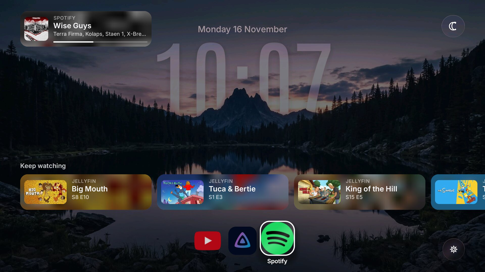
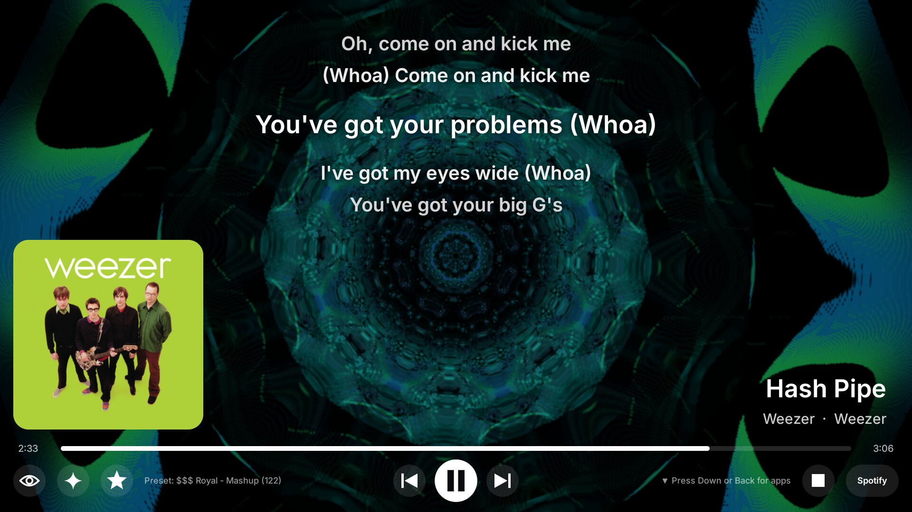
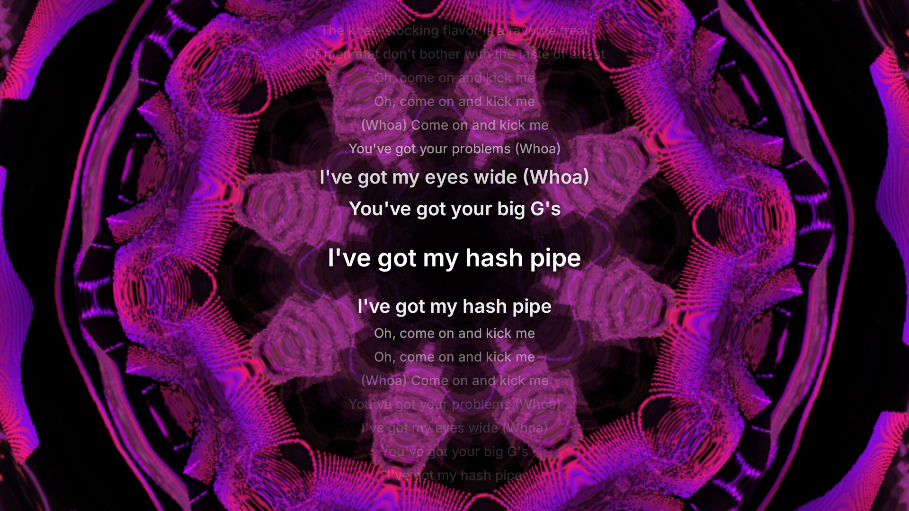
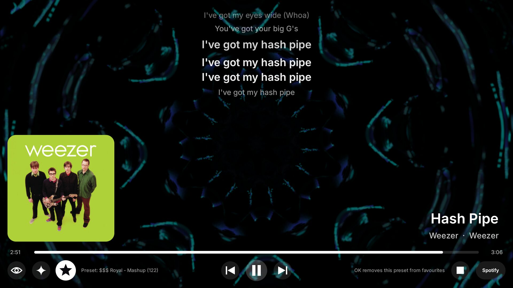
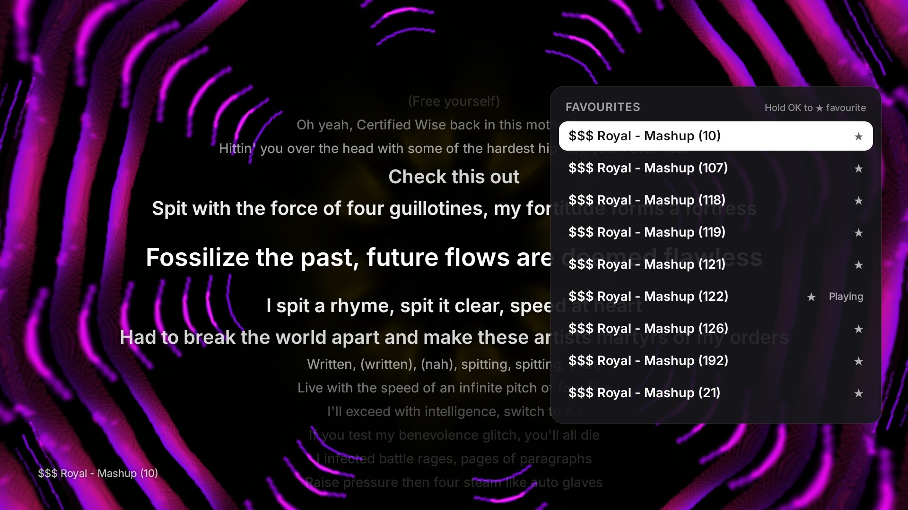
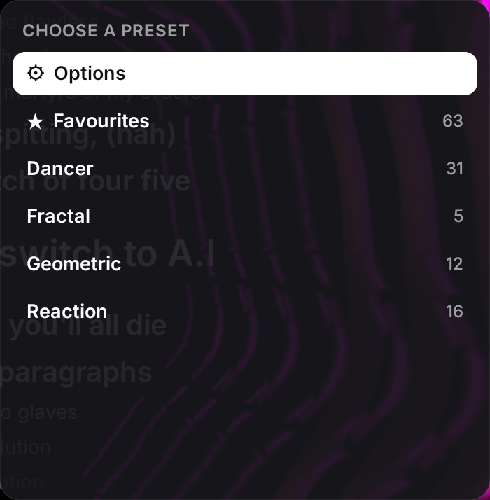
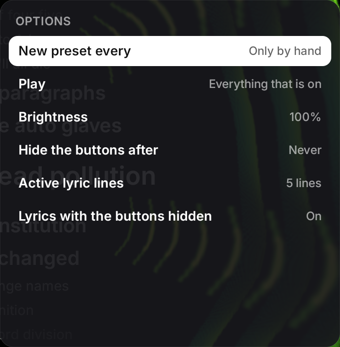

# tvhome (couch-tv-android-native)

A native Android TV home screen with no WebView and no libraries, aimed at slow, low-memory TVs
(about 1.4 GB RAM). Inspired by [couch-tv](https://github.com/Seagey/couch-tv) by Seagey (MIT) and
reusing parts of its code: see `NOTICE.md`.

**Status:** working. It runs as the home screen on two real Android 11 TVs with 1.4 GB of RAM (about 45 MB for the app).
What it does: a clock and scenes, Keep watching and Now playing cards, a dock, More apps, Home settings, people and kids mode,
Smart Idle, Home Assistant cards and a doorbell, and a full-screen music view with synced lyrics and an optional MilkDrop visualiser.
See `STATUS.md` for the details and `note.md` for the plan.

By lukemonaghan. App id `com.lukemonaghan.tvhome`. Android 6 (API 23) and up.

## Screenshots
Taken on the Android TV emulator at 1920 x 1080, with sample accounts and sample shows.



### Music view
A full-screen player for whatever is playing (Spotify and other apps that show a media session), with time-synced lyrics from
[LRCLIB](https://lrclib.net) and an optional MilkDrop visualiser behind them.



- **Lyrics** wrap to the screen instead of being cut off. The current line is large with extra room around it, and "Active lyric
  lines" (1, 3, 5 or 7) sets how many lines around it show large.
- **Hide the buttons** with the eye button or the Up key. Left and Right then change the brightness, and Up, Down or OK bring the buttons back.
- **Presets:** Channel Up and Down move to the next or previous preset. The preset stays put between visits to the music view,
  and with "Only by hand" it never changes by itself.
- **★ favourite** the preset that is playing, and play favourites only if you like.
- **Clock:** Settings, "Clock on music view" shows a small clock in the top right corner (off by default), for when you are watching or listening before you have to leave.
- The music view does not open by itself when the TV turns on or you press Home with music already playing: you land on Home. It opens by itself only for a new song.





### Preset picker
OK on the ✦ button opens the picker. Moving over a preset plays it full size behind the list, OK keeps it, and any other way out puts
the old one back. Hold OK on a preset to star or unstar it.



| Browse | Options |
| --- | --- |
|  |  |

Presets that ran too slowly on a TV are skipped, and Settings still previews them, small and slow, so you can see what they were.

## Build and run
You need a JDK 17 and the Android SDK (`JAVA_HOME`, `ANDROID_HOME`).
```sh
./gradlew assembleDebug
```
The APK is `app/build/outputs/apk/debug/app-debug.apk`. Try it on an emulator first, then measure memory on a real TV
(`dumpsys meminfo com.lukemonaghan.tvhome`). `tools/install.sh` and `tools/undo.sh` set the app up as the home on a TV and put the old one back.
Read `reference/upstream/AGENTS.md` and `CLAUDE.md` before changing a real TV.

### Music visualiser (optional)
The visualiser uses projectM (LGPL-2.1). Its libraries are not in this repository. Build them with the Android NDK:
```sh
ANDROID_HOME=/path/to/sdk sh tools/build-native.sh        # armeabi-v7a, arm64-v8a and x86
```
Without them the app builds and runs, and the music view keeps its blurred cover. No presets are bundled: pick and download them in
Settings, Music visualiser. They are MilkDrop presets from the projectM project, each by its own author.

## Licence
MIT, see `LICENSE`. Third-party code, fonts and pictures, and what the LGPL means for projectM, are in `NOTICE.md`; licence texts are in `licenses/`.

## Layout
- `app/` the Android app.
- `reference/upstream/` couch-tv code, scripts, docs and web UI, copied unchanged as a spec. Not compiled.
- `note.md` the plan.
